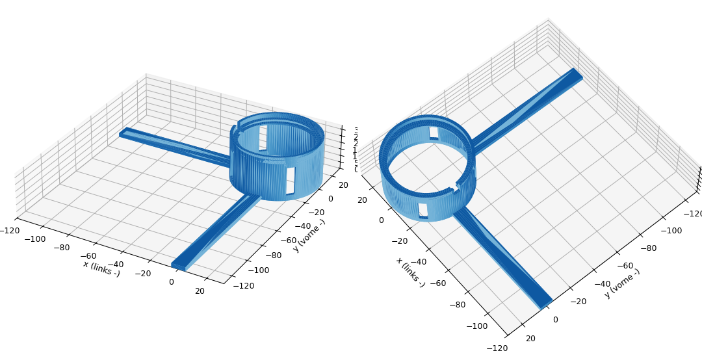

🇩🇪 Deutsch · 🇬🇧 [English summary](#english)

# Qi-Pad-Halter für die Ladeschublade

Parametrischer 3D-Druck-Halter (FreeCAD), der ein rundes Qi-Ladepad auf fester
Höhe und Position in einer Ladeschublade hält.

Entstanden für das Projekt **„Smarte Ladeschublade mit Home Assistant – ganz ohne Cloud“**
auf dem Blog [Smarthome? Aber sicher!](https://smarthome-aber-sicher.de) –
dort steht die ganze Geschichte: Schublade, Steckdose, Shelly und die
Automatisierung, die erkennt, wann das Handy fertig geladen ist.

**Passend für:** den magnetischen **EVOline Qi-Lader** (rundes Pad, Ø 57,7 mm)
im **EVOline PowerOrganiser** mit Schubkasteneinsatz. Die Stege schieben den
Halter – genau wie das EVOline-Steckdosengehäuse – in die linke vordere Ecke
der Schublade. Andere runde Qi-Pads lassen sich über die Maßtabelle anpassen.

> Eigene Konstruktion von Joachim Wilke, kein offizielles EVOline-Zubehör.



## Aufbau

Eine Röhre, die senkrecht in der Schublade steht. Das Qi-Pad liegt oben mit dem
Rand auf einem schmalen Innenring. Die Mitte bleibt offen, und vier
Lüftungsschlitze lassen die Wärme abziehen. Ein 3 mm hoher Rand hält das Pad
seitlich, ein kleiner Ausschnitt führt das Kabel heraus, ohne dass es das Pad
anhebt. Zwei flache Stege am Boden laufen bis an die linke und die vordere
Schubladenwand: reinlegen, in die Ecke schieben, festschrauben – das Pad liegt
immer an derselben Stelle.

## Dateien

| Datei | Inhalt |
|---|---|
| `qi-pad-halter.stl` | Fertiger Halter für den Slicer |
| `qi-pad-halter-passtest.stl` | Nur der obere Ring (ca. 9 mm) – schneller Passtest fürs Pad |
| `qi-pad-halter.FCStd` | FreeCAD-Modell mit Maßtabelle `Params` |
| `qi_pad_halter.py` | Skript, das das Modell komplett neu aufbaut |
| `qi-halter-petg.curaprofile` | Cura-Profil (PETG, Anycubic Vyper) |

## Drucken

- Material: **PETG** (verträgt die Wärme des Pads besser als PLA).
- Stehend drucken, ohne Stützmaterial: unter dem Auflagering sitzt eine 45°-Fase.
- Erst den Passtest drucken – passt das Pad, dann den ganzen Halter.
- Getestet: komplett gedruckt und in der Schublade im Einsatz.

## Anpassen an dein Pad und deine Schublade

Alle Maße stehen im Spreadsheet **Params** der `.FCStd`. Wert ändern, FreeCAD
rechnet neu, dann das Objekt `QiPadHalter` als STL exportieren. Alternativ die
Werte im Skript ändern und es ausführen:

```bash
/Applications/FreeCAD.app/Contents/Resources/bin/freecadcmd qi_pad_halter.py
```

| Alias | Wert (mm) | Bedeutung |
|---|---|---|
| `padD` | 57,7 | Durchmesser Qi-Pad |
| `padT` | 5,9 | Dicke Qi-Pad |
| `padTop` | 33,5 | Höhe der Pad-**Oberseite** über dem Boden |
| `gap` | 0,3 | radiales Spiel zwischen Pad und Röhre |
| `wall` | 2 | Wandstärke |
| `ledge` | 3 | Breite des Auflagerings |
| `lipH` | 3 | Höhe des Rands über der Auflage |
| `cableW` / `cableDepth` | 5 / 4 | Kabelausschnitt: Breite / Tiefe unter der Auflage |
| `slotW` / `slotBottom` | 6 / 4 | Lüftungsschlitze: Breite / Unterkante |
| `distLeft` | 120 | Pad-Mitte bis linke Schubladenwand |
| `distFront` | 130 | Pad-Mitte bis vordere Schubladenwand |
| `barW` / `barH` | 10 / 3 | Querschnitt der Anschlagstege |

Abgeleitet: `rIn = padD/2 + gap`, `rOut = rIn + wall`, `rHole = rIn − ledge`,
`ledgeZ = padTop − padT`, `tubeH = ledgeZ + lipH`. Mit den Startwerten:
Außendurchmesser 62,3 mm, Höhe 30,6 mm, ca. 17,5 cm³ Material.

Koordinaten: Ursprung in der Pad-Mitte auf dem Schubladenboden, −X zur linken
Wand, −Y zur vorderen Wand.

## Lizenz

© Joachim Wilke, [smarthome-aber-sicher.de](https://smarthome-aber-sicher.de)

Lizenziert unter [Creative Commons Namensnennung – Nicht kommerziell 4.0 International (CC BY-NC 4.0)](https://creativecommons.org/licenses/by-nc/4.0/deed.de).
Nachbauen, verändern und teilen ausdrücklich erwünscht – mit Namensnennung und
Link auf das Blog, aber nicht für kommerzielle Zwecke (z. B. Verkauf gedruckter Halter).

---

## English

A parametric 3D-printable holder (FreeCAD) that keeps a round Qi charging pad at
a fixed height and position inside a charging drawer. Built for the project
"Smart charging drawer with Home Assistant – no cloud" on the German blog
[Smarthome? Aber sicher!](https://smarthome-aber-sicher.de).

Print `qi-pad-halter-passtest.stl` first to check the fit, then
`qi-pad-halter.stl` in PETG, upright, no supports. Adapt all dimensions in the
`Params` spreadsheet of `qi-pad-halter.FCStd` or in `qi_pad_halter.py`.

Licensed under [CC BY-NC 4.0](https://creativecommons.org/licenses/by-nc/4.0/) –
attribution required, no commercial use.
